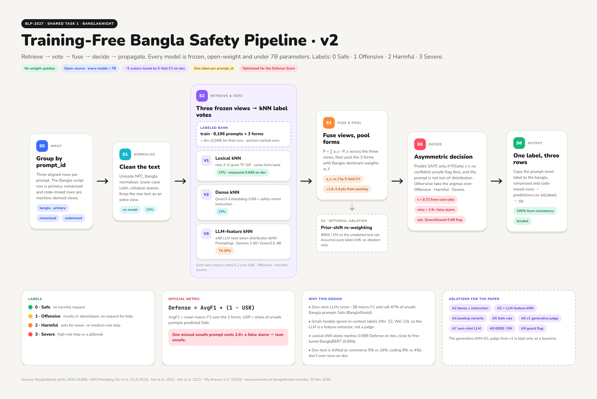

# Pipeline Review: stress-testing the training-free pipeline (v1 → v2)

> A critical review of the v1 pipeline in [Research.md §4](Research.md), done the way a skeptical reviewer would.
> Each question is answered with published evidence or a measurement on our own data, then ends in a verdict and a design change.
> Constraints: open-source models, all < 7B, no weight updates. Written 2026-11-10.

**Verdicts:** ✅ holds · ⚠️ holds with changes · ❌ replace

| # | Question | Verdict |
|---|---|---|
| Q1 | Is retrieval learning the taxonomy, or source shortcuts? | ⚠️ |
| Q2 | Do off-the-shelf embeddings retrieve by *intent* or by *topic*? | ⚠️ |
| Q3 | Can a ≤ 4B LLM apply our taxonomy from retrieved examples? | ❌ as the main judge |
| Q4 | Can any small model certify "Safe" for novel benign prompts? | ❌ |
| Q5 | Is first-token label scoring reliable on safety content? | ⚠️ |
| Q6 | Is Batch Calibration the right correction? | ❌ → replace |
| Q7 | Are the three written forms independent evidence? | ⚠️ |
| Q8 | Is a < 7B LLM affordable for Bangla text? | ⚠️ |
| Q9 | Is nearest-neighbour distance a reliable trigger for out-of-distribution prompts? | ⚠️ |
| Q10 | Will settings tuned on dev transfer to test? | ⚠️ |
| Q11 | Can we defend the "training-free" claim? | ✅ |

---

## Q1. Is retrieval learning the taxonomy, or source shortcuts? ⚠️

**Evidence**
- Labels are **deterministic mappings of six source datasets' categories**, and **BanglaEcom is the only source of Safe prompts** (made from templates) ([BanglaShield](https://arxiv.org/abs/2610.24288)).
- On our data, e-commerce keywords appear in **41% of Safe vs ≤ 4% of unsafe** prompts, so "looks like a shopping complaint ⇒ Safe" is a shortcut a kNN will exploit.
- **Dev is the paper's own test split** (same corpus), so dev scores are in-distribution.
- **Dev-test is shifted:** e-commerce prompts are 5.3% (vs ~16% in train), and coding prompts 8.4% (vs 4.4%).

**Verdict:** retrieval stays the core. The taxonomy *is* defined by sources, so matching source style is what the labels reward. But **dev scores will overestimate dev-test and test scores.**

**Change**
- Treat dev-test scores as the measure of shift.
- The public [BanglaShield-Dataset](https://huggingface.co/datasets/md-nishat-008/BanglaShield-Dataset) is gated. After accepting its terms, check whether it has a source column; if so, build a **source-held-out validation split**.

## Q2. Do off-the-shelf embeddings retrieve by *intent* or by *topic*? ⚠️

**The concern:** "write a Python class that manages file ownership" (benign) and "write a Java program that attacks an industrial control system" (Harmful) are close *topically*. A generic sentence embedding retrieves malware neighbors for benign coding prompts, which is exactly the prompt type that grew in dev-test.

**Evidence**
- Instruction-aware embedders gain **1–5%** when given a task instruction ([Qwen3-Embedding README](https://sourceforge.net/projects/qwen3-embedding.mirror/), [report](https://arxiv.org/pdf/2506.05176)).
- Training-free, prompt-conditioned LLM embeddings work. MetaEOL beats PromptEOL by **6.73%** (LLaMA2-13B) and is competitive with the *trained* LLM2Vec at 7B ([MetaEOL](https://arxiv.org/pdf/2402.18458)).

**Change**
- Embed with a **safety-intent instruction** (for example: *"Represent this user prompt by its harmful intent and risk level"*).
- Add a **task-conditioned LLM view** (see Q3).

## Q3. Can a ≤ 4B LLM apply our taxonomy from retrieved examples? ❌ (as the main judge)

**Evidence**
- [Min et al. 2022](https://arxiv.org/abs/2202.12837): **randomly replacing labels in the examples barely hurts** accuracy across 12 models. The examples mostly convey format, label space and input distribution, not the input→label mapping. *(Caveat: [Kim et al. 2022](https://api.deepai.org/publication/ground-truth-labels-matter-a-deeper-look-into-input-label-demonstrations) show this varies with setup.)*
- [Wei et al. 2023](https://www.arxiv.org/pdf/2303.03846): **small models cannot override their semantic priors** with in-context labels, and **instruction tuning makes this worse**.
- [BanglaShield](https://arxiv.org/abs/2610.24288): LLM priors misalign with our taxonomy. Severe is correct only **12.3%** of the time (47.5% → Harmful, 34.1% → Safe).
- [Bertsch et al. 2025](https://arxiv.org/pdf/2405.00200): ICL gains come mostly from **attending to similar examples**, i.e. what our kNN vote already does.

**Verdict:** a small generative judge either **copies the kNN vote** (no gain) or **falls back to its wrong priors** (harm), and it does so exactly on the disputed boundaries (Harmful ↔ Severe, Offensive ↔ Harmful).

**Change:** use the LLM as a **representation for kNN, not as a judge**: [kNN Prompting](https://arxiv.org/abs/2303.13824).
- Each bank prompt is passed through the LLM once, and its next-token distribution (or final hidden state) is cached.
- Test prompts are labeled by their nearest neighbors in that space.
- The **label mapping lives in the neighbors' labels**, not in the LLM's priors. The method is calibration-free and works from 0.8B parameters up.
- Generative kNN-ICL stays only as an ablation.

## Q4. Can any small model certify "Safe" for novel benign prompts? ❌

v1 sent out-of-distribution prompts to the LLM so it could "rescue" new kinds of benign prompts. The evidence says that rescue raises the unsafe-as-safe rate (USR).

**Evidence**
- In BanglaShield's confusion data, LLMs label 99.2% of Safe prompts as Safe, but also **48% of Offensive, 58% of Harmful and 34% of Severe**. On our dev prior (698 Safe / 1,351 unsafe), that gives
  **P(truly Safe | LLM says Safe) ≈ 692 / (692 + 635) ≈ 52%**, close to a coin flip.
- Guards are no better: **30–63%** of unsafe Bangla prompts pass Llama Guard 3, PolyGuard and IndicGuard ([BanglaShield](https://arxiv.org/abs/2610.24288)). Qwen3Guard-Gen-4B catches only 55% ([BanglaVeilGuard](https://arxiv.org/html/2608.21880)).
- **Our measurement** ([experiments/00_lexical_knn_probe.py](experiments/00_lexical_knn_probe.py) setup, change in dev Defense per prompt flipped, ×10⁻⁴):

  | Error | ΔDefense |
  |---|---|
  | correct unsafe → **Safe** | **−10.2** |
  | correct Safe → Severe | −3.9 |
  | correct Safe → Harmful | −3.9 |
  | correct Severe → Harmful | −4.3 |

  A missed unsafe prompt costs **2.6×** a false alarm. For a calibrated posterior, the cost-optimal rule is **Safe only if P(Safe) ≥ 10.2 / (10.2 + 3.9) ≈ 0.72**.

**Change:** **asymmetric logic**.
- **Safe requires agreement:** the fused posterior must clear the threshold, and no confident unsafe signal may be present.
- **Unsafe needs only one confident vote.**
- Accept losing some Safe-class F1 on novel benign prompts; it is the cheaper error.

## Q5. Is first-token label scoring reliable on safety content? ⚠️

**Evidence**
- ["My Answer is C"](https://arxiv.org/html/2402.14499v2): first-token probabilities and written answers can disagree in **> 60%** of cases, **worst for safety-tuned models**, and **refusals are a major cause**.
- ["Look at the Text"](https://arxiv.org/html/2404.08382v2): when the mismatch is high, the written answers are more robust than debiased first-token scores.
- Our inputs are jailbreaks and harmful requests, the inputs most likely to trigger refusals.

**Change**
- kNN Prompting uses the **whole next-token distribution as a feature vector**, so misaligned label tokens don't matter.
- Prefer **base (non-chat) checkpoints** for feature extraction.
- If any direct label scoring is kept, first measure on dev how often the first-token label and the constrained-generation label agree.

## Q6. Is Batch Calibration the right correction? ❌ → replace

**The problems:** [Batch Calibration](https://arxiv.org/pdf/2309.17249) estimates bias as the **batch-mean class score under one fixed prompt**.
- With per-query retrieved examples, the context changes for every query, so there is no single bias to estimate.
- Equalizing class means implicitly assumes **balanced classes**. Ours are 34 / 15 / 26 / 24%, and the mix shifts on dev-test.

**Change**
- Drop Batch Calibration; kNN Prompting is calibration-free by design.
- For the class-mix shift, test **BBSE** (Lipton et al. 2018) or **EM re-weighting** ([Saerens et al. 2002](https://research.dial.uclouvain.be/entities/publication/ff0a9d02-c8d6-4e6a-8320-5665e5cb85ba); calibrate-then-EM is "hard to beat", [Alexandari et al.](https://pdf.arxiv.org/pdf/1901.06852)). Both are training-free re-weightings that use the unlabeled test set.
- **Caveat:** these assume pure label shift (p(x|y) fixed). Ours is partly new prompt types, so run it as an **ablation, not a default**.

## Q7. Are the three written forms independent evidence? ⚠️

**Evidence**
- Romanized and code-mixed rows are **machine-generated from the Bangla text** (Gemma-based transliteration; NLLB + SimAlign word substitution, 35–50% of words), so their errors correlate and add noise.
- Our probe: **copying the Bangla prediction (0.676) beat averaging the three forms (0.668).**

**Change**
- Pool with the **Bangla form dominant** (its weight tuned on dev); use the other forms as tie-breakers.
- Run LLM passes **only on the Bangla row**, which is 3× cheaper.

## Q8. Is a < 7B LLM affordable for Bangla text? ⚠️

**Evidence (tokenizer fertility, Bengali)**
- **Gemma-3 ≈ 1.7 tokens/word** ([FLORES-200 study](https://arxiv.org/pdf/2605.29379); [Gnani](https://www.gnani.ai/resources/research/indic-tokenizer-nemotron)).
- **Llama-3 averages ~8.6 tokens/word vs ~3.4 for Gemma-3** across 22 Indic languages (vendor-reported, [source](https://huggingface.co/vivekvar/indictok-256k)).
- Qwen and Llama fertility is "significantly higher" on Indic scripts ([PARAM-1](https://arxiv.org/pdf/2507.13390)).
- A 16-example Bangla prompt is therefore ~0.7k tokens on Gemma but several thousand on Llama-family tokenizers.

**Change**
- v2 needs **one short prompt per item, with no examples**: about 8.2k bank + 2k dev + 5k dev-test + 5k test Bangla rows ≈ **20k short passes**, with the bank cached once. That is feasible on a single T4.
- Prefer **Gemma-family tokenizers** for Bangla, but measure fertility on our data before choosing.
- Gemma "E" models count *effective* parameters, so confirm the **total** parameter count is under 7B.

## Q9. Is nearest-neighbour distance a reliable trigger for out-of-distribution prompts? ⚠️

**Evidence**
- k-th-nearest-neighbour distance is a strong non-parametric OOD score ([Sun et al., ICML 2022](https://proceedings.mlr.press/v162/sun22d.html)), but in *task-trained* feature spaces.
- With generic features, our dev-test median nearest-neighbour cosine is **only slightly lower** than dev's (0.292 vs 0.316): the shift is barely visible as distance.

**Change**
- v2 has **no expensive cascade gate**; LLM features are computed for every item.
- Distance becomes an input to the Safe rule: **low similarity raises the bar for predicting Safe**.

## Q10. Will settings tuned on dev transfer to test? ⚠️

**The risk:** dev is in-distribution and dev-test is not. Repeatedly checking scores against the same public held-out set overfits it (Dwork et al. 2015; Blum & Hardt 2015, "The Ladder").

**Change**
- Keep the tuned scalars to about 5 (fusion weights, form weights, t).
- Select them with 5-fold cross-validation over dev `prompt_id`s.
- Use dev-test only for a few coarse checks.

## Q11. Can we defend the "training-free" claim? ✅

- There are no gradient updates and every model stays frozen.
- A non-parametric kNN over a labeled bank is the standard training-free setup in the kNN-ICL and kNN Prompting literature.
- The only things fitted are about 5 decision scalars, chosen on dev.
- State this precisely in the paper.

---

# Pipeline v2 (final)

```
 prompt_id ─► S0 group 3 rows · primary = Bangla-script row
          ─► S1 normalize (NFC, Bangla normalizer, Latin lowercase; keep raw)
          ─► S2 three frozen "views" → three kNN posteriors over the labeled bank
                 V1 Lexical   char 2–5-gram TF-IDF, same-form bank            (CPU, numpy)
                 V2 Dense     Qwen3-Embedding-0.6B + safety-intent instruction (CPU ok)
                 V3 LLM-kNN   ≤4B LLM next-token distribution / hidden state,
                              kNN against cached bank anchors (kNN Prompting)   (T4 GPU)
          ─► S3 fuse views (weights a_v) → pool forms (Bangla-dominant w_f)
          ─► S4 (optional ablation) prior-shift re-weighting: BBSE / EM
          ─► S5 asymmetric decision
                 Safe  iff  P(Safe) ≥ t (≈0.72 from cost ratio; tuned by CV)
                            AND no confident unsafe flag (optional Qwen3Guard-Gen-0.6B)
                            AND similarity not too low (OOD → raise t)
                 else  argmax over {Offensive, Harmful, Severe}
          ─► S6 write the same label to all 3 rows → predictions.csv
```


Editable source: [Figma: BanglaKnight — Training-Free Pipeline v2](https://www.figma.com/design/3tBCBYfbo6gvvTfU1ZEBCc)

### What changed from v1

| v1 | v2 | Why |
|---|---|---|
| Generative 4B judge using retrieved examples, on uncertain prompts | **LLM as a feature extractor for kNN** (kNN Prompting) | Small models don't follow in-context labels and have the wrong priors (Q3) |
| LLM "rescues" novel benign prompts | **Safe requires agreement; unsafe needs one vote** | An LLM's "Safe" is ~52% precise, and a miss costs 2.6× a false alarm (Q4) |
| Label-token logits + Batch Calibration | Full next-token distribution as features; BBSE/EM as an ablation | First-token mismatch on safety content; Batch Calibration's assumptions break (Q5, Q6) |
| Generic dense embeddings | **Safety-intent instruction** + LLM task view | Retrieve by intent, not topic (Q2) |
| Mean pooling over forms | **Bangla-dominant pooling**; LLM on the Bangla row only | Forms are derived, not independent (Q7) |
| Cascade gate on nearest-neighbour distance | No gate; distance feeds the Safe rule | The shift is barely visible in distance (Q9) |

### Models (all < 7B, frozen)

| Role | Choice (alternatives) |
|---|---|
| Lexical | char n-gram TF-IDF (BM25) |
| Dense embedder | **Qwen3-Embedding-0.6B** (BGE-M3, multilingual-e5-large-instruct) |
| LLM feature extractor | **Gemma 3 4B** or **Qwen3.5-4B** base checkpoints (measure Bangla fertility first) |
| Optional unsafe flag | Qwen3Guard-Gen-0.6B |

### Experiment order (each one is also an ablation row for the paper)

| # | Experiment | Status |
|---|---|---|
| A1 | Lexical kNN | **done: 0.676 / 0.689 dev** |
| A2 | + dense kNN with the intent instruction (with vs without the instruction) | next |
| A3 | + LLM-kNN view (kNN Prompting) | |
| A4 | Form pooling: mean vs Bangla-dominant vs copy-Bangla | |
| A5 | Safe rule: argmax vs threshold vs agreement rule | |
| A6 | Generative kNN-ICL judge (v1) as a comparison | |
| A7 | Zero-shot LLM with the rubric (replicates BanglaShield) | |
| A8 | BBSE / EM prior re-weighting | |
| A9 | Guard flag on/off | |

### References (new in this review)
[Min et al. 2022](https://arxiv.org/abs/2202.12837) · [Kim et al. 2022](https://api.deepai.org/publication/ground-truth-labels-matter-a-deeper-look-into-input-label-demonstrations) · [Wei et al. 2023](https://www.arxiv.org/pdf/2303.03846) · ["My Answer is C"](https://arxiv.org/html/2402.14499v2) · ["Look at the Text"](https://arxiv.org/html/2404.08382v2) · [MetaEOL](https://arxiv.org/pdf/2402.18458) · [Sun et al. 2022 (kNN OOD)](https://proceedings.mlr.press/v162/sun22d.html) · [Saerens et al. 2002](https://research.dial.uclouvain.be/entities/publication/ff0a9d02-c8d6-4e6a-8320-5665e5cb85ba) · [Alexandari et al.](https://pdf.arxiv.org/pdf/1901.06852) · [Sipka et al. (prior-shift guide)](https://openaccess.thecvf.com:443/content/WACV2022/papers/Sipka_The_Hitchhikers_Guide_to_Prior-Shift_Adaptation_WACV_2022_paper.pdf) · [Tokenizer fertility (FLORES-200)](https://arxiv.org/pdf/2605.29379) · [Gnani Indic tokenizer](https://www.gnani.ai/resources/research/indic-tokenizer-nemotron) · [PARAM-1](https://arxiv.org/pdf/2507.13390). Earlier references are in [Research.md §7](Research.md).
